# Lab Report: Bidirectional Dijkstra, A* and Hill Climbing on OpenStreetMap

*Generated automatically by `dijkstra_osm_visualizer.ipynb` on 2026-11-06. Re-run the notebook to refresh every number and figure.*

**Instance:** Centro Storico, Lucca, Italy (walk network), seed 42. Start A = OSM node 620893001, goal B = OSM node 402980103, 1,772 m apart in a straight line, optimal walking distance 2,426.5 m.

---

# 1. Design

## 1.1 Problem formulation

The path-finding task is a classic single-agent search problem:

| Element | Definition in this project |
|---|---|
| **State** | an intersection (OSM node) where the walker currently stands |
| **Initial state** | A, a randomly chosen intersection (seeded) |
| **Goal test** | the current state is B, another seeded intersection at least 50 % of the map diagonal away |
| **Actions** | walk along one street segment to an adjacent intersection |
| **Transition model** | `RESULT(u, walk to v) = v` |
| **Step cost** | length of the street segment in metres (OSM `length`) |
| **Path cost** | sum of the step costs along the route |
| **Solution** | a sequence of intersections from A to B; optimal = minimum path cost |
| **Environment** | fully observable, deterministic, static, discrete, known map |

Concrete instance: 559 states, 1,380 actions, mean branching factor 2.47 (max 4).

## 1.2 Problem state-space diagram

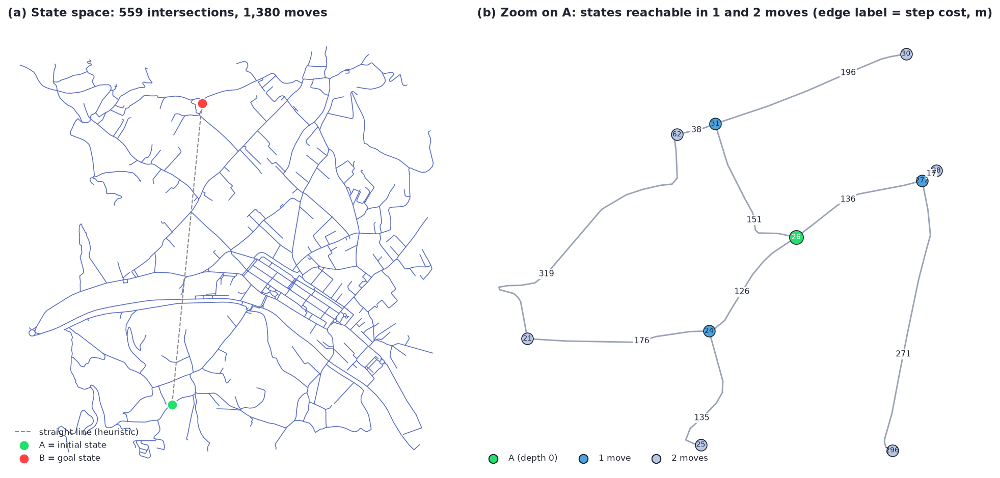

*Figure 1. State space of the problem: all intersections (left) and the first two layers around A with step costs (right)*

## 1.3 Search algorithm workflow / flowcharts

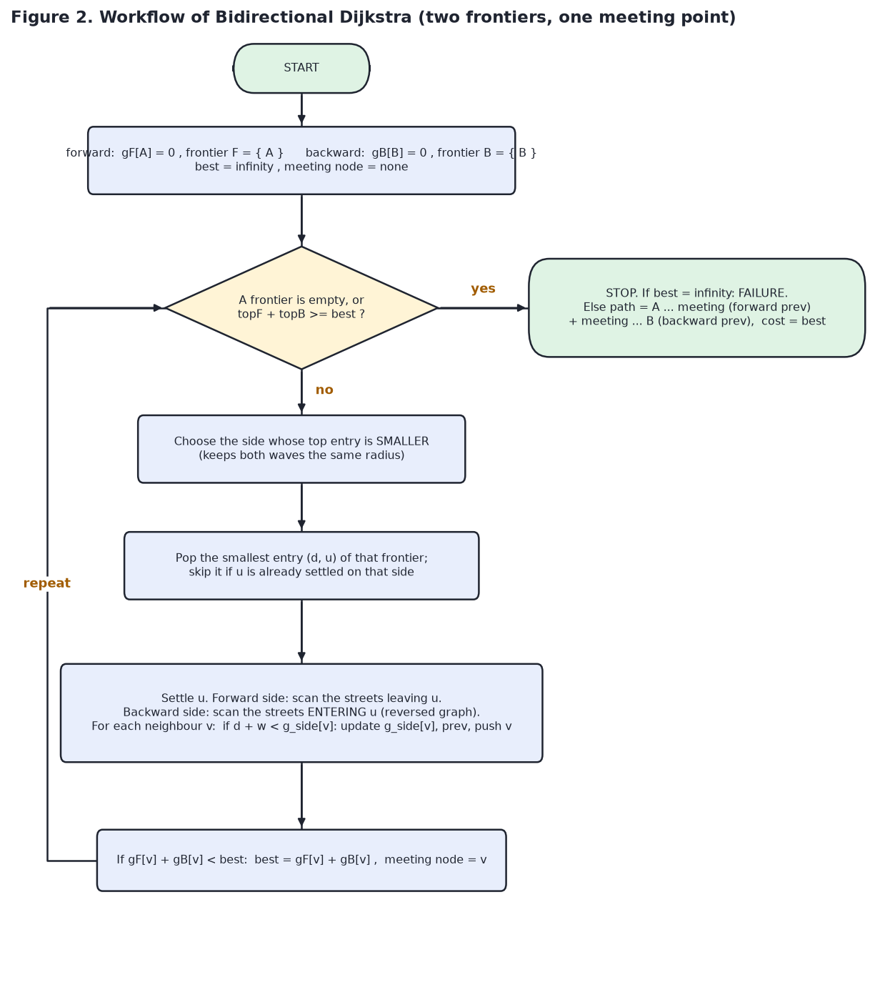

*Figure 2. Workflow of Bidirectional Dijkstra*

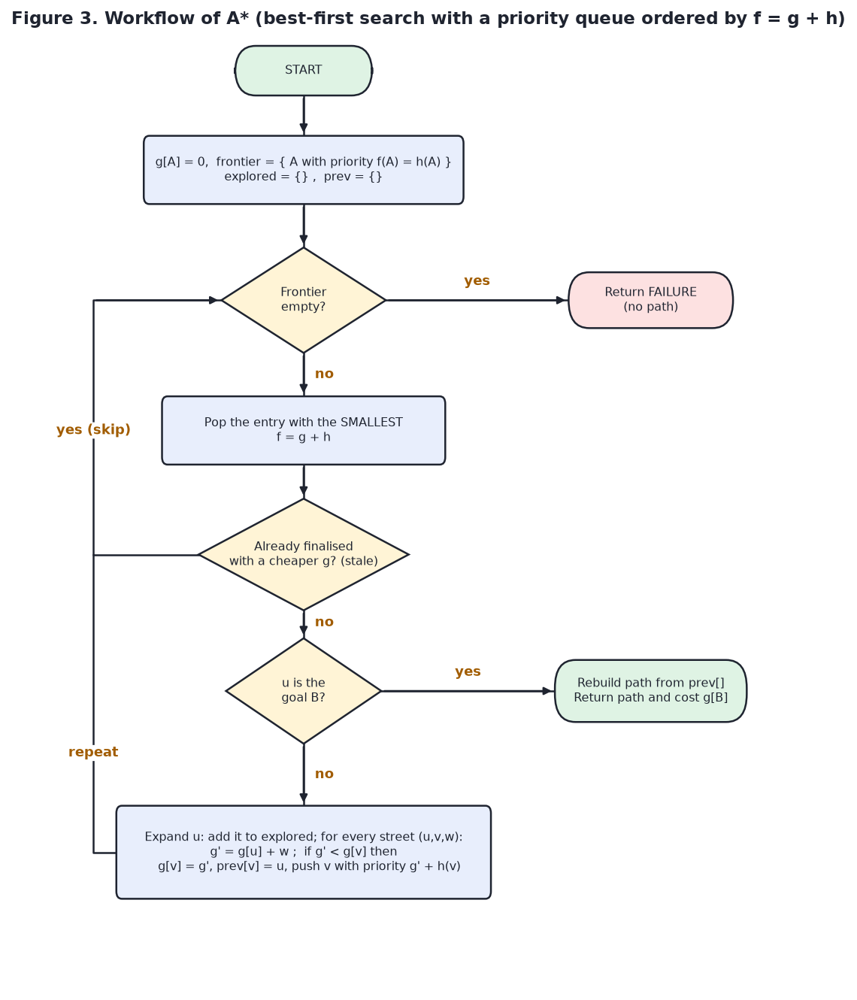

*Figure 3. Workflow of A**

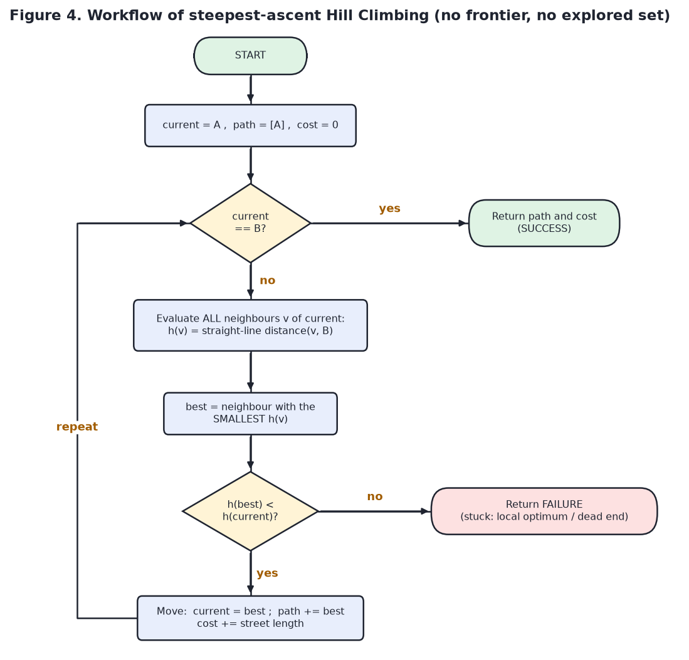

*Figure 4. Workflow of Hill Climbing*

## 1.4 Search tree / state-space graph

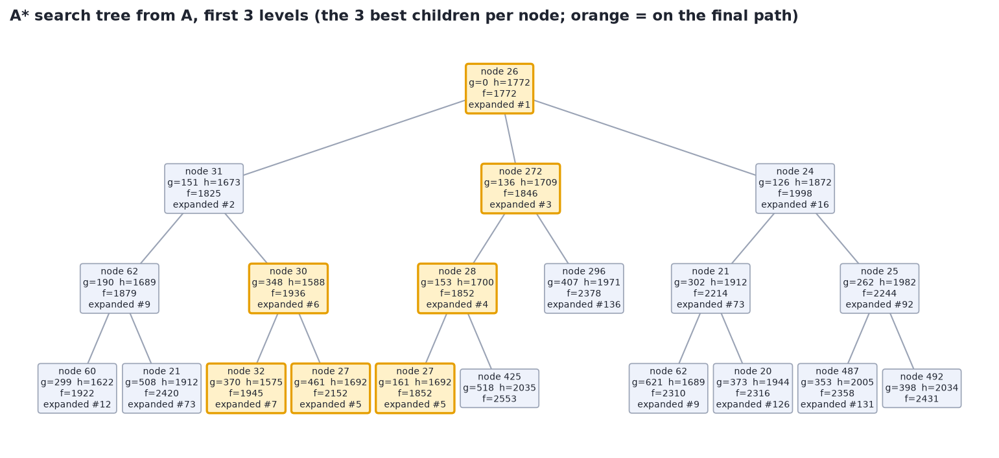

*Figure 5. First levels of the A* search tree with g, h and f values and the order in which A* expanded the nodes*

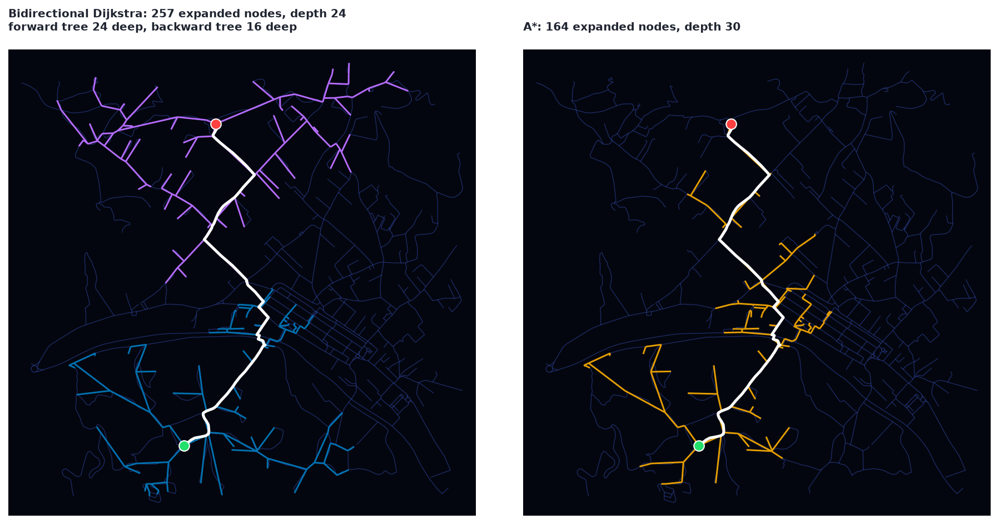

*Figure 6. Search trees drawn on the map (edge = parent -> child of every expanded node; Bidirectional Dijkstra has a blue tree grown from A and a purple tree grown from B)*

Search-tree size: Bidirectional Dijkstra 257 nodes (143 forward, depth 24; 114 backward, depth 16); A* 164 nodes / depth 30.

## 1.5 Algorithm-specific design and pseudocode

**Bidirectional Dijkstra: two Dijkstra waves, one from A over the streets and one from B over the reversed streets**
```text
BIDIRECTIONAL_DIJKSTRA(graph, A, B):
    gF[A] <- 0 ; gB[B] <- 0 ; all other distances <- infinity
    frontierF <- min-priority-queue { (0, A) }          # forward wave, follows streets
    frontierB <- min-priority-queue { (0, B) }          # backward wave, follows streets in reverse
    best <- infinity ; meeting <- none
    while frontierF and frontierB are not empty:
        if top(frontierF) + top(frontierB) >= best: break          # the waves have met, best is optimal
        side <- the frontier whose top entry is smaller             # keeps both waves the same radius
        (d, u) <- side.pop_min()
        if u is already settled on this side: continue              # stale entry
        settle u on this side
        for each neighbour v of u (forward: streets leaving u, backward: streets entering u) with length w:
            if d + w < g_side[v]:
                g_side[v] <- d + w ; prev_side[v] <- u ; side.push((d + w, v))
            if gF[v] + gB[v] < best:                                # a route A -> v -> B exists
                best <- gF[v] + gB[v] ; meeting <- v
    if meeting = none: return FAILURE
    return (A ... meeting via prevF) + (meeting ... B via prevB), best
```
**A\* : one best-first search ordered by f = g + h**
```text
ASTAR(graph, A, B):
    h(x) <- straight_line_distance(x, B)                # admissible heuristic
    g[A] <- 0 ; prev <- {}
    frontier <- min-priority-queue { (h(A), A) }        # ordered by f = g + h
    while frontier is not empty:
        (f, u) <- frontier.pop_min()
        if this entry is stale (g at push time > g[u]): continue
        if u = B: return RECONSTRUCT(prev, B), g[B]
        for each street (u, v) with length w:
            if g[u] + w < g[v]:                         # a closed node can be re-opened here
                g[v] <- g[u] + w ; prev[v] <- u
                frontier.push((g[v] + h(v), v))
    return FAILURE
```
**Hill Climbing (steepest ascent): always step to the neighbour closest to B**
```text
HILL_CLIMBING(graph, A, B):
    current <- A ; path <- [A]
    loop:
        if current = B: return path, SUCCESS
        best <- the neighbour v of current with the smallest h(v)
        if h(best) >= h(current): return path, FAILURE  # local optimum: no neighbour is better
        current <- best ; path.append(best)
```
| | Bidirectional Dijkstra | A* | Hill Climbing |
|---|---|---|---|
| Strategy | cheapest `g` first, from both ends, stop when the waves meet | cheapest `g + h` first | greedy on `h`, one state |
| Needs the goal known in advance | yes (starts a wave there) | yes | yes |
| Needs a heuristic | no | yes | yes |
| Complete | yes | yes | **no** (local optima) |
| Optimal | yes | yes (admissible `h`) | **no** |
| Time | O((V+E) log V), two searches of about half the radius | O((V+E) log V), usually far fewer nodes | O(b d) |
| Space | O(V) (two sets of arrays) | O(V) | O(1) extra |

## 1.6 Frontier and explored-set representation

| | Bidirectional Dijkstra | A* | Hill Climbing |
|---|---|---|---|
| **Frontier** | **two** binary min-heaps (`heapq`) of `(g, node)`: forward from A, backward from B | one binary min-heap of `(f, g, node)` | none: only the single `current` node |
| **Priority** | `g(n)` = distance from the wave's own root | `f(n) = g(n) + h(n)` | `h(n)` of the neighbours (chosen greedily) |
| **Explored set** | one *settled* set per wave (the `done` flags); stale heap entries are skipped (lazy deletion) | `explored` = nodes popped & expanded; a node may be re-opened if a cheaper `g` appears | not kept (it cannot revisit a node anyway, `h` must strictly decrease) |
| **Bookkeeping** | `dist`/`prev` arrays for each wave (size V each), `best` cost and `meeting` node; the backward wave uses the **reversed adjacency** `radj` | `g[]`, `prev[]`, `h[]` (size V) | `path` list only |
| **Stop rule** | `top(F) + top(B) >= best` | goal popped from the heap | goal reached, or no better neighbour |

The tables below replay the first expansions and show exactly what the frontiers and explored sets contain.

**Bidirectional Dijkstra** - first expansion steps

| step | side | expand node | dist from its root m | frontier size (fwd + bwd) | explored (fwd + bwd) | best A-B cost so far m | next in this frontier (node:dist) |
|---|---|---|---|---|---|---|---|
| 1 | forward | 26 | 0.0 | 0 + 1 | 1 + 0 | - |  |
| 2 | backward | 165 | 0.0 | 3 + 0 | 1 + 1 | - |  |
| 3 | backward | 162 | 67.4 | 3 + 2 | 1 + 2 | - | 164:73, 166:359 |
| 4 | backward | 164 | 73.5 | 3 + 2 | 1 + 3 | - | 163:74, 166:359 |
| 5 | backward | 163 | 74.5 | 3 + 2 | 1 + 4 | - | 436:234, 166:359 |
| 6 | forward | 24 | 126.1 | 2 + 4 | 2 + 4 | - | 272:136, 31:151 |

**A*** - first expansion steps

| step | expand node | g m | h m | f m | frontier size | explored set size | next best in frontier (node:f) |
|---|---|---|---|---|---|---|---|
| 1 | 26 | 0.0 | 1772.1 | 1772.1 | 0 | 1 |  |
| 2 | 31 | 151.5 | 1673.1 | 1824.6 | 2 | 2 | 272:1846, 24:1998 |
| 3 | 272 | 136.2 | 1709.5 | 1845.7 | 3 | 3 | 62:1879, 30:1936, 24:1998 |
| 4 | 28 | 152.8 | 1699.6 | 1852.4 | 4 | 4 | 62:1879, 30:1936, 24:1998 |
| 5 | 27 | 160.9 | 1691.6 | 1852.5 | 5 | 5 | 62:1879, 30:1936, 24:1998 |
| 6 | 30 | 273.6 | 1587.7 | 1861.3 | 6 | 6 | 62:1879, 30:1936, 29:1940 |

**Hill Climbing** - first expansion steps

| step | expand node | h(node) m | frontier | explored set size | neighbour h (m) | decision |
|---|---|---|---|---|---|---|
| 1 | 26 | 1772.1 | - (single current state) | 1 | 31:1673, 272:1709, 24:1872 | move to 31 |
| 2 | 31 | 1673.1 | - (single current state) | 1 | 30:1588, 62:1689, 26:1772 | move to 30 |
| 3 | 30 | 1587.7 | - (single current state) | 1 | 32:1575, 31:1673, 27:1692 | move to 32 |
| 4 | 32 | 1574.8 | - (single current state) | 1 | 34:1482, 33:1549, 30:1588 | move to 34 |
| 5 | 34 | 1482.3 | - (single current state) | 1 | 431:1327, 430:1495, 32:1575 | move to 431 |
| 6 | 431 | 1326.9 | - (single current state) | 1 | 34:1482 | STOP (local optimum) |

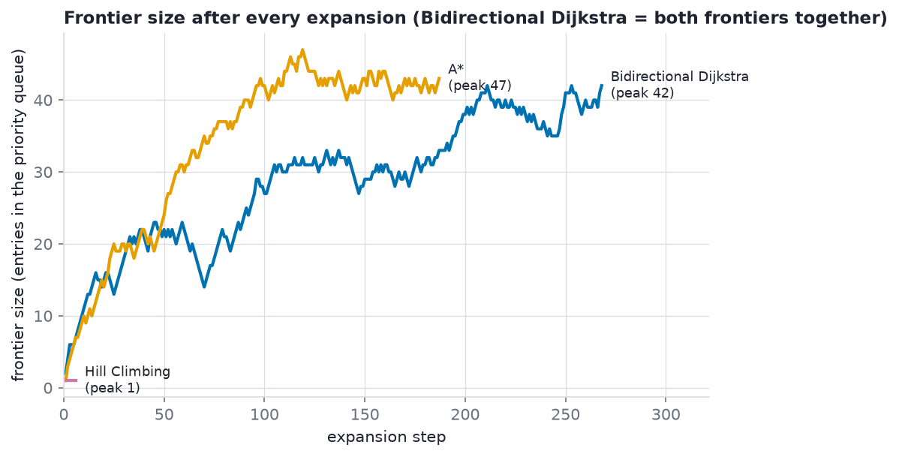

*Figure 7. Frontier size after every expansion*

## 1.7 Heuristic function design

* **Function:** `h(n)` = straight-line (Euclidean) distance in metres between intersection `n` and the goal B, computed on the projected (UTM, metre) coordinates of the map. It is used by **A\*** (inside `f = g + h`) and by **Hill Climbing** (as its only guide). **Bidirectional Dijkstra is uninformed and does not use `h`**; it gets its speed-up from searching from both ends instead.
* **Why it is a good choice:** a street can never be shorter than the straight line between its two ends, so the true remaining cost `h*(n)` is always at least `h(n)`. That makes `h` **admissible** (never overestimates), which guarantees A* returns an optimal path. It is also cheap: one subtraction and one square root per node.
* **Consistency:** `h(u) <= w(u,v) + h(v)` holds on (almost) every edge (the triangle inequality). The few tiny violations measured below come from map-projection distortion (centimetres); A* is implemented so it stays optimal even then.
* **Relationship between the algorithms:** with `h = 0`, A* would turn into plain one-sided Dijkstra; Hill Climbing uses the same `h` but only as a local compass (it never looks at `g`).
* **Weakness:** the straight line ignores walls, rivers and one-way detours, so `h` is sometimes much smaller than `h*` in a medieval centre like Lucca. Hill Climbing is fooled by exactly those places.

| Property | Measured on this map |
|---|---|
| Admissible (h <= h*) | violations: 0 of 559 nodes; largest h/h* = 0.965 |
| Informedness | mean h/h* = 70.4% |
| Consistent (h(u) <= w(u,v) + h(v)) | violations: 2 of 1,380 edges (largest excess 6.90 cm, from map-projection distortion; A* re-opens closed nodes so optimality is unaffected) |

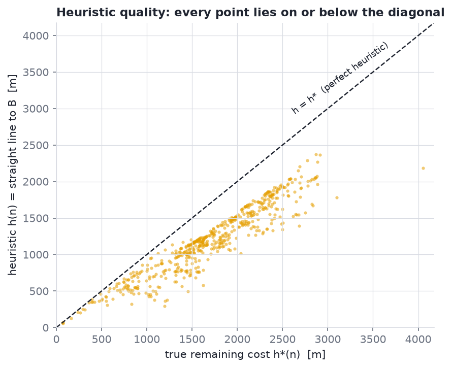

*Figure 8. Heuristic h versus true remaining cost h**

---

# 2. Implementation

## 2.1 Dataset loading and preprocessing

This project has no tabular dataset: the data is a **street network from OpenStreetMap**, loaded and prepared by the notebook:

1. `load_graph`: geocode `PLACE` to a polygon (or fall back to a radius around it), download the walkable street network with OSMnx, shrink the area until it has at most `MAX_NODES` nodes, and cache it in `osm_cache/` so reruns are offline and instant.
2. `clean_graph`: project to the local UTM zone (metres), drop self-loops, keep the largest strongly-connected component (so every pair of nodes is mutually reachable), repair missing edge lengths.
3. `pick_endpoints`: pick A and B with a seeded RNG, far enough apart, and confirm a route exists.
4. `build_problem`: convert the graph to compact adjacency lists (`adj`, node coordinates `xy`, drawable segments) that every algorithm and renderer shares.

Resulting dataset:

| Item | Value |
|---|---|
| Place / network | Centro Storico, Lucca, Italy / walk |
| Data source | address + 1,200 m radius [loaded from local cache] |
| Raw OSM graph | 559 nodes, 1,408 edges |
| After cleaning (self-loops removed, largest strongly-connected component) | 559 nodes, 1,404 edges |
| Projected CRS (metres) | EPSG:32632 |
| Search problem (parallel edges merged) | 1,380 directed moves, 690 drawable street segments |
| Total street length | 58.3 km (mean move 84.5 m) |
| Map diagonal | 3,385 m |
| Start / goal (seed 42) | OSM 620893001 -> OSM 402980103, 1,772 m apart in a straight line |

## 2.2 Model implementation and training

**Not applicable.** Bidirectional Dijkstra, A* and Hill Climbing are classical search algorithms: they have no learned parameters, so there is no training set, loss function or training loop. The "model" is the **problem model** (the state-space graph built above, including its reversed copy for the backward search) plus the hand-designed heuristic `h`. The algorithms are implemented from scratch with `heapq` and verified against `networkx.shortest_path_length` (see section 7).

## 2.3 Prediction generation

For a search algorithm the "prediction" is the **solution path** it returns for the pair (A, B): the sequence of intersections, its length in metres and its number of steps. Bidirectional Dijkstra and A* are validated to equal the true shortest path; Hill Climbing returns either a path to B or the partial walk where it got stuck. Paths of this run:

- Bidirectional Dijkstra: reached B | 31 nodes, 30 edges, 2,426.5 m | OSM ids: 620893001 -> 849906847 -> 2574785532 -> 268101182 -> ... -> 2834816962 -> 402980028 -> 402980103
- A*: reached B | 31 nodes, 30 edges, 2,426.5 m | OSM ids: 620893001 -> 849906847 -> 2574785532 -> 268101182 -> ... -> 2834816962 -> 402980028 -> 402980103
- Hill Climbing: STOPPED before B | 6 nodes, 5 edges, 629.6 m | OSM ids: 620893001 -> 401837619 -> 268101193 -> 268101194 -> 2574785609 -> 2574785660

## 2.4 Code snippets for key functionalities

#### Preprocessing - clean the raw OSM graph

```python
def clean_graph(G_raw, network_type, log=print):
    """Project to metres, drop self-loops, keep the largest strongly connected component,
    and make sure every edge has a usable 'length' (metres)."""
    if G_raw.number_of_nodes() == 0:
        raise PipelineError(f"The downloaded graph is empty. {_advice(network_type)}")
    G = ox.project_graph(G_raw)                                   # local UTM zone, metres
    loops = list(nx.selfloop_edges(G, keys=True))
    G.remove_edges_from(loops)
    G = ox.truncate.largest_component(G, strongly=True)
    filled = 0
    for u, v, k, d in G.edges(keys=True, data=True):
        try:
            length = float(d.get("length"))
        except (TypeError, ValueError):
            length = float("nan")
        if not math.isfinite(length) or length < 0:
            geom = d.get("geometry")
            length = float(geom.length) if geom is not None else math.dist(
                (G.nodes[u]["x"], G.nodes[u]["y"]), (G.nodes[v]["x"], G.nodes[v]["y"]))
            filled += 1
        d["length"] = length
    if G.number_of_nodes() < 2 or G.number_of_edges() == 0:
        raise PipelineError(f"No usable roads: the largest strongly connected component has "
                            f"{G.number_of_nodes()} node(s). {_advice(network_type)}")
    log(f"  Cleaned graph: {G.number_of_nodes():,} nodes, {G.number_of_edges():,} edges "
        f"(removed {len(loops)} self-loops, filled {filled} missing lengths, CRS {G.graph['crs']})")
    return G
```

#### Building the search problem (adjacency lists, coordinates)

```python
def build_problem(G) -> SearchProblem:
    """Convert the cleaned networkx MultiDiGraph into compact adjacency lists."""
    node_ids = list(G.nodes)
    index = {n: i for i, n in enumerate(node_ids)}
    xy = np.array([(G.nodes[n]["x"], G.nodes[n]["y"]) for n in node_ids], dtype=float)

    best = {}                                      # (u, v) -> (length, data): keep shortest parallel edge
    for u, v, d in G.edges(data=True):
        key = (index[u], index[v])
        if key not in best or d["length"] < best[key][0]:
            best[key] = (d["length"], d)

    adj = [[] for _ in node_ids]
    adj_seg = [[] for _ in node_ids]
    seg_of, seg_uv, seg_pts, seg_len, edge_pts = {}, [], [], [], {}
    for (ui, vi), (length, d) in best.items():
        pts = _edge_points(d, xy[ui], xy[vi])
        edge_pts[(ui, vi)] = pts
        und = (ui, vi) if ui < vi else (vi, ui)
        oriented = pts if ui == und[0] else pts[::-1]
        if und not in seg_of:                      # first time we see this street piece
            seg_of[und] = len(seg_uv)
            seg_uv.append(und)
            seg_pts.append(oriented)
            seg_len.append(length)
        elif length < seg_len[seg_of[und]]:        # the other direction is shorter: use its shape
            seg_pts[seg_of[und]] = oriented
            seg_len[seg_of[und]] = length
        adj[ui].append((vi, length))
        adj_seg[ui].append(seg_of[und])
    adj_seg = [tuple(s) for s in adj_seg]
    radj = [[] for _ in node_ids]                  # reversed adjacency: who can reach v in one step?
    radj_seg = [[] for _ in node_ids]
    for u in range(len(adj)):
        for (v, w), s in zip(adj[u], adj_seg[u]):
            radj[v].append((u, w))
            radj_seg[v].append(s)
    radj_seg = [tuple(s) for s in radj_seg]
    return SearchProblem(node_ids, index, xy, adj, adj_seg, seg_uv, seg_pts, edge_pts, radj, radj_seg)
```

#### Bidirectional Dijkstra

```python
def bidirectional_dijkstra(problem: SearchProblem, source: int, target: int, trace: Optional[Trace] = None) -> SearchResult:
    adjs = (problem.adj, problem.radj)             # side 0 follows streets, side 1 follows them backwards
    n = len(problem.adj)
    dist = ([math.inf] * n, [math.inf] * n)        # dist[0][x] = cost A -> x,  dist[1][x] = cost x -> B
    prev = ([-1] * n, [-1] * n)                    # prev[0][x] = node before x (towards A), prev[1][x] = node after x (towards B)
    done = (bytearray(n), bytearray(n))            # settled flags, one per search
    dist[0][source] = 0.0
    dist[1][target] = 0.0
    heaps = ([(0.0, source)], [(0.0, target)])     # the two frontiers
    best, meet = math.inf, -1                      # cheapest known A -> B cost and the node where the waves touch
    expanded = 0
    generated = max_front = 2
    if trace is not None:
        segs, record, stamp = (problem.adj_seg, problem.radj_seg), trace.events.append, trace.times.append
        clock = time.perf_counter
        t0 = clock()

    while heaps[0] and heaps[1]:
        if heaps[0][0][0] + heaps[1][0][0] >= best:        # the waves have met: no shorter route can exist
            break
        side = 0 if heaps[0][0][0] <= heaps[1][0][0] else 1   # advance the search with the smaller radius
        other = 1 - side
        if len(heaps[0]) + len(heaps[1]) > max_front:
            max_front = len(heaps[0]) + len(heaps[1])
        d, u = heapq.heappop(heaps[side])
        if done[side][u]:
            continue                                       # stale heap entry (lazy deletion)
        done[side][u] = 1
        expanded += 1
        if trace is not None:
            record((u, segs[side][u], side)); stamp(clock() - t0)
        for v, w in adjs[side][u]:
            nd = d + w
            if nd < dist[side][v]:
                dist[side][v] = nd
                prev[side][v] = u
                generated += 1
                heapq.heappush(heaps[side], (nd, v))
            total = dist[side][v] + dist[other][v]         # a route A -> v -> B through this node
            if total < best:
                best, meet = total, v

    if meet < 0:
        return SearchResult([], math.inf, expanded, False, generated, max_front, None)
    left = [meet]                                          # A ... meet, via the forward predecessors
    while left[-1] != source:
        left.append(prev[0][left[-1]])
    left.reverse()
    right, x = [], meet                                    # meet ... B, via the backward "successors"
    while x != target:
        x = prev[1][x]
        right.append(x)
    return SearchResult(left + right, best, expanded, True, generated, max_front, prev)
```

#### Heuristic function

```python
def euclidean_heuristic(problem: SearchProblem, target: int) -> list:
    """h[n] = straight-line distance in metres from every node to the target (projected coordinates)."""
    d = problem.xy - problem.xy[target]
    return np.hypot(d[:, 0], d[:, 1]).tolist()
```

#### A*

```python
def astar(problem: SearchProblem, source: int, target: int, trace: Optional[Trace] = None) -> SearchResult:
    adj = problem.adj
    n = len(adj)
    h = euclidean_heuristic(problem, target)
    g = [math.inf] * n             # best known cost from the source
    prev = [-1] * n
    g[source] = 0.0
    heap = [(h[source], 0.0, source)]   # frontier: (f = g + h, g at push time, node)
    expanded, generated, max_front = 0, 1, 1
    if trace is not None:
        adj_seg, record, stamp = problem.adj_seg, trace.events.append, trace.times.append
        clock = time.perf_counter
        t0 = clock()

    reached = False
    while heap:
        if len(heap) > max_front:
            max_front = len(heap)
        f, gu, u = heapq.heappop(heap)             # node with the smallest f
        if gu > g[u]:
            continue                               # stale entry: a cheaper route to u was found later
        expanded += 1
        if u == target:                            # goal popped -> optimal because h never overestimates
            reached = True
            if trace is not None:
                record((u, (), 0)); stamp(clock() - t0)
            break
        if trace is not None:
            record((u, adj_seg[u], 0)); stamp(clock() - t0)
        for v, w in adj[u]:
            ng = gu + w
            if ng < g[v]:                          # better route to v (a closed node may be re-opened)
                g[v] = ng
                prev[v] = u
                generated += 1
                heapq.heappush(heap, (ng + h[v], ng, v))

    if not reached:
        return SearchResult([], math.inf, expanded, False, generated, max_front, prev)
    path = [target]
    while path[-1] != source:
        path.append(prev[path[-1]])
    path.reverse()
    return SearchResult(path, g[target], expanded, True, generated, max_front, prev)
```

#### Hill Climbing

```python
def hill_climbing(problem: SearchProblem, source: int, target: int, trace: Optional[Trace] = None) -> SearchResult:
    adj = problem.adj
    h = euclidean_heuristic(problem, target)
    current, path, cost = source, [source], 0.0
    expanded = 0
    if trace is not None:
        adj_seg, record, stamp = problem.adj_seg, trace.events.append, trace.times.append
        clock = time.perf_counter
        t0 = clock()

    while True:
        expanded += 1
        if current == target:
            if trace is not None:
                record((current, (), 0)); stamp(clock() - t0)
            break
        if trace is not None:                      # all neighbours of `current` are evaluated below
            record((current, adj_seg[current], 0)); stamp(clock() - t0)
        best, best_w = -1, 0.0
        for v, w in adj[current]:
            if h[v] < h[current] and (best < 0 or h[v] < h[best]):
                best, best_w = v, w                # steepest ascent = smallest h among improving neighbours
        if best < 0:                               # no neighbour is better -> local optimum, give up
            break
        current = best
        path.append(current)
        cost += best_w

    return SearchResult(path, cost, expanded, current == target, expanded, 1, None)
```

---

# 3. Results

## 3.1 Project interface screenshots

The interface of this project is the animated search viewer (HTML5 canvas, plus an MP4 export of the same animation). Blue = streets explored by the forward wave of Bidirectional Dijkstra and purple = its backward wave, amber = A*, pink = Hill Climbing, white = final path, green = A, red = B, the header shows the live node counter and time.

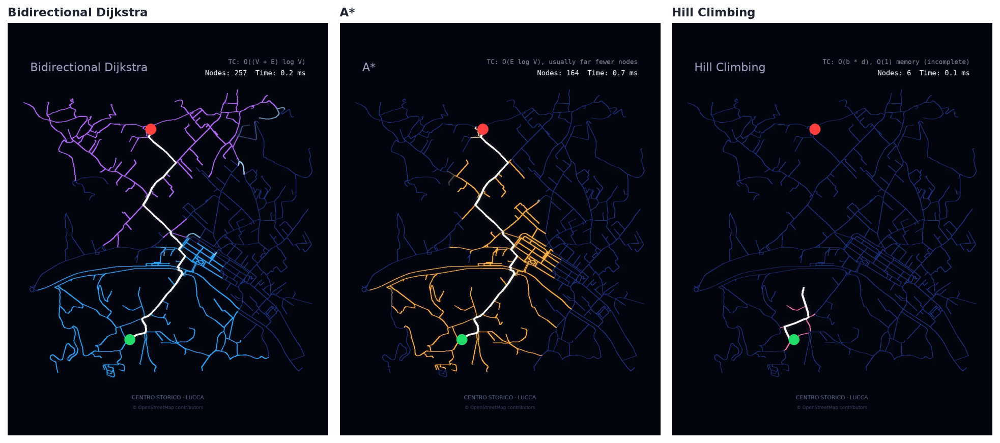

*Figure 9. Interface: final frame of each algorithm's animation (also saved one by one as results/interface_*.png)*

Animation files:

- **Bidirectional Dijkstra**: `exports/bidirectional-dijkstra-e76453_centro-storico-lucca-italy-e9cb17.html` (interactive HTML5), `exports/bidirectional-dijkstra-e76453_centro-storico-lucca-italy-e9cb17.mp4` (video)
- **A***: `exports/a-4cac2d_centro-storico-lucca-italy-e9cb17.html` (interactive HTML5), `exports/a-4cac2d_centro-storico-lucca-italy-e9cb17.mp4` (video)
- **Hill Climbing**: `exports/hill-climbing-3b0983_centro-storico-lucca-italy-e9cb17.html` (interactive HTML5), `exports/hill-climbing-3b0983_centro-storico-lucca-italy-e9cb17.mp4` (video)

## 3.2 Search results and solution paths

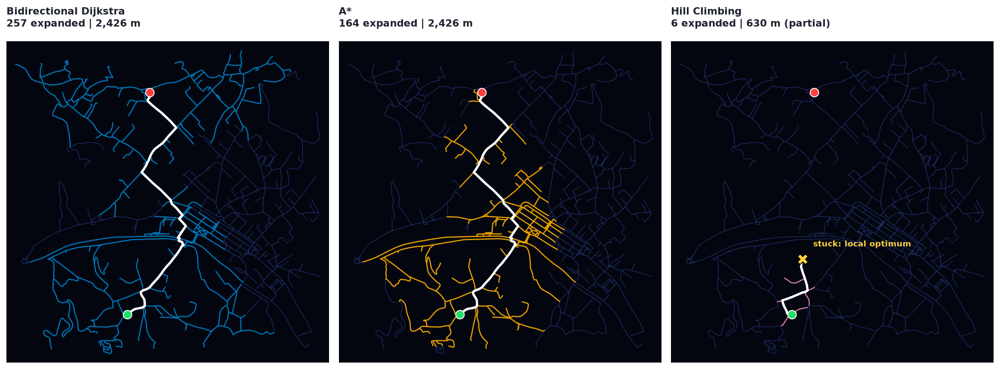

*Figure 10. Explored streets and solution path of each algorithm (X marks where Hill Climbing got stuck)*

- Bidirectional Dijkstra: reached B | 31 nodes, 30 edges, 2,426.5 m | OSM ids: 620893001 -> 849906847 -> 2574785532 -> 268101182 -> ... -> 2834816962 -> 402980028 -> 402980103
- A*: reached B | 31 nodes, 30 edges, 2,426.5 m | OSM ids: 620893001 -> 849906847 -> 2574785532 -> 268101182 -> ... -> 2834816962 -> 402980028 -> 402980103
- Hill Climbing: STOPPED before B | 6 nodes, 5 edges, 629.6 m | OSM ids: 620893001 -> 401837619 -> 268101193 -> 268101194 -> 2574785609 -> 2574785660

## 3.3 Performance evaluation: execution time, memory usage and nodes expanded

| Metric | Bidirectional Dijkstra | A* | Hill Climbing |
|---|---|---|---|
| Goal reached | yes | yes | NO (stuck) |
| Path cost (m) | 2426.5 | 2426.5 | 629.6 |
| Cost vs optimal | +0.0% | +0.0% | 1,327 m short of B |
| Solution depth (edges) | 30 | 30 | 5 |
| Nodes expanded | 257 | 164 | 6 |
| Nodes generated | 309 | 229 | 6 |
| Peak frontier | 42 | 47 | 1 |
| Explored share | 46.0% | 29.3% | 1.1% |
| Streets scanned | 339 | 241 | 11 |
| Time (ms, median) | 1.34 | 0.733 | 0.087 |
| Peak memory (KiB) | 24.6 | 30.6 | 28.4 |

Time = median of 20 uninstrumented runs; memory = `tracemalloc` peak of one run (includes the heuristic table, `g`/`prev` arrays and the priority queue); "Nodes expanded" counts nodes removed from the frontier and processed (for Hill Climbing: states visited).

> **Timing caveat:** absolute milliseconds depend on the machine and on how Python is run (a Jupyter kernel can be several times slower than a plain `python` process), and the timings in 3.6 were taken in a different cell, so compare the **ratios between algorithms**, not the absolute values, and do not compare numbers across tables.

## 3.4 Path cost and solution depth

| Algorithm | Goal reached | Path cost (m) | Cost vs optimal | Solution depth (edges) |
|---|---|---|---|---|
| Bidirectional Dijkstra | yes | 2426.5 | +0.0% | 30 |
| A* | yes | 2426.5 | +0.0% | 30 |
| Hill Climbing | NO (stuck) | 629.6 | 1,327 m short of B | 5 |

Optimal cost (networkx reference): **2,426.5 m**. Solution depth = number of street segments walked.

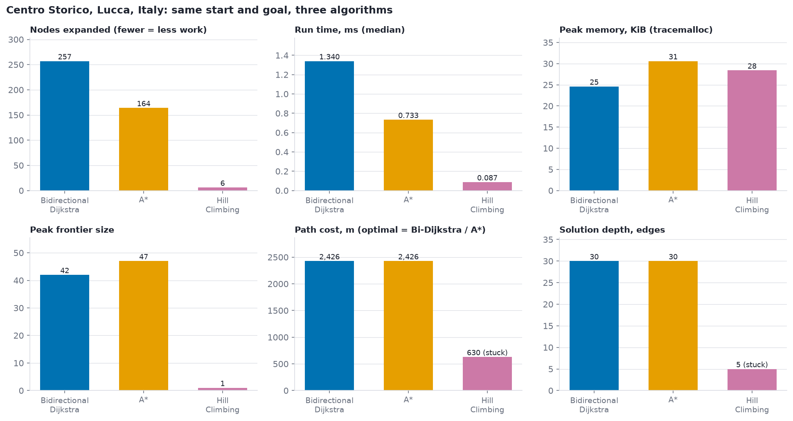

*Figure 11. Performance comparison on the main instance*

## 3.5 Visualization of the search process

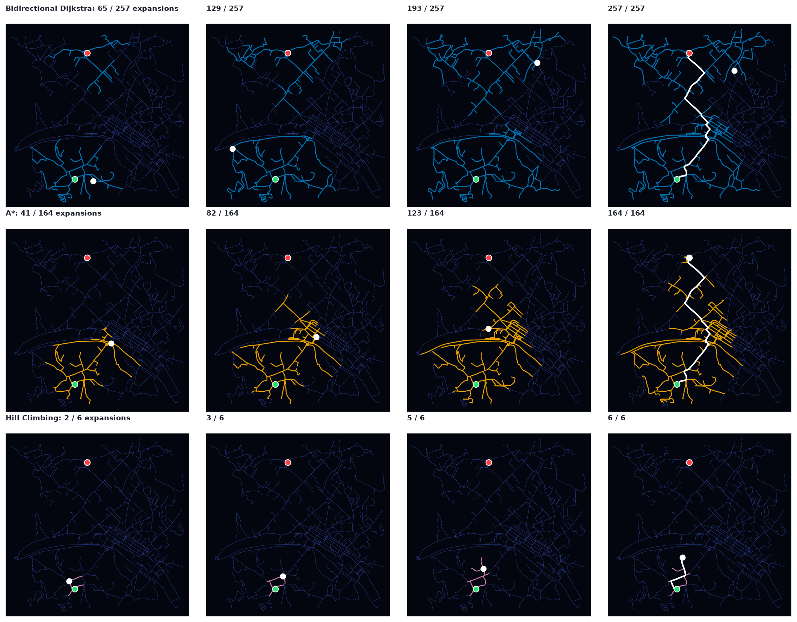

*Figure 12. Explored region after 25 / 50 / 75 / 100 % of each search (the white dot is the node being expanded)*

## 3.6 Statistical comparison over 200 random start/goal pairs

| Metric | Bidirectional Dijkstra | A* | Hill Climbing |
|---|---|---|---|
| Success rate | 100.0% | 100.0% | 10.5% |
| Mean nodes expanded | 283.2 | 130.8 | 10.1 |
| Median nodes expanded | 289.0 | 115.0 | 8.0 |
| Mean time (ms) | 2.324 | 1.116 | 0.18 |
| Mean cost / optimal (solved) | 1.0 | 1.0 | 1.0637 |
| Optimal when solved | 100.0% | 100.0% | 4.8% |

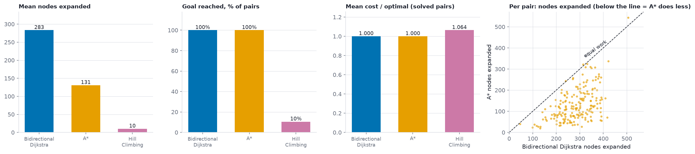

*Figure 13. Averages over random start/goal pairs, and per-pair work of A* versus Bidirectional Dijkstra*

## 3.7 Comparison across towns

| Town | Nodes | Optimal cost (m) | Bi-Dijkstra expanded | A* expanded | A* / Bi-Dijkstra | Same cost (A*) | Hill Climbing | HC expanded |
|---|---|---|---|---|---|---|---|---|
| Centro Storico | 559 | 2426.5 | 257 | 164 | 64% | yes | stuck, 1,327 m from B | 6 |
| Bruges | 3119 | 2475.1 | 1993 | 1303 | 65% | yes | stuck, 1,722 m from B | 8 |
| Chefchaouen | 1071 | 2324.2 | 858 | 557 | 65% | yes | stuck, 1,680 m from B | 2 |
| Sidi Bou Said | 292 | 1736.5 | 189 | 103 | 54% | yes | stuck, 928 m from B | 8 |
| Hallstatt | 29 | 2175.3 | 14 | 10 | 71% | yes | stuck, 1,067 m from B | 4 |

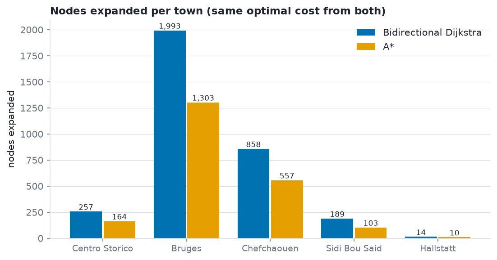

*Figure 14. Nodes expanded by Bidirectional Dijkstra and A* in different towns*

## 3.8 Comparative analysis of the search algorithms

| Property | Bidirectional Dijkstra | A* | Hill Climbing |
|---|---|---|---|
| Uses heuristic | no | yes | yes |
| Complete | yes | yes | no |
| Optimal | yes | yes (if `h` admissible) | no |
| Time complexity | O((V+E) log V), two half-radius waves | O((V+E) log V) worst case, usually far less | O(b d) |
| Space complexity | O(V) | O(V) | O(1) extra |
| Exploration shape | two circles that grow towards each other | stretched towards B | a single thin line |
| Needs | reversible graph + known goal | good admissible heuristic | good heuristic, luck |
| Weakness | blind: explores in every direction | needs a good heuristic, memory heavy | stuck in dead ends |

#### Observed on this project

- **Optimality.** Bidirectional Dijkstra and A* both returned 2,426.5 m, identical to the networkx optimum (2,426.5 m). Over 200 random pairs both matched the networkx optimum in 100.0% (Bidirectional Dijkstra) and 100.0% (A*) of their solved pairs.
- **Search effort.** Bidirectional Dijkstra expanded **257 nodes** (143 from A + 114 from B) and A* **164**, i.e. A* did 36% fewer expansions on this instance (241 vs 339 streets scanned). Averaged over 200 pairs A* expanded 130.8 nodes vs 283.2 for Bidirectional Dijkstra (54% fewer). Both waves of Bidirectional Dijkstra stay small, but it cannot aim at B, while A* can.
- **Time.** The median run took 1.340 ms (Bidirectional Dijkstra), 0.733 ms (A*) and 0.087 ms (Hill Climbing). A* pays a small per-node cost for the heuristic, and Bidirectional Dijkstra runs two heaps; on a graph this small both effects are tiny.
- **Memory.** Peak traced memory: Bidirectional Dijkstra 24.6 KiB (two sets of `dist`/`prev` arrays), A* 30.6 KiB (it stores the heuristic table), Hill Climbing 28.4 KiB. Peak frontier (both heaps together): 42 (Bidirectional Dijkstra), 47 (A*), 1 (Hill Climbing).
- **Hill Climbing failed on this instance:** it stopped after 6 nodes, 1,327 m (straight line) short of B, because no neighbour was closer to B than the node it stood on (a local optimum). Over 200 random pairs it reached the goal in only **10.5%** of the pairs, but it expanded just 10.1 nodes on average.
- **Heuristic quality.** h was admissible on all 559 nodes (largest h/h* = 0.96) and on average 70% of the true remaining distance, which is why A* is optimal and focused on B. Bidirectional Dijkstra needs no heuristic at all: its saving comes from meeting in the middle.

## 3.9 Conclusion

* Use the algorithm A* when a good admissible heuristic exists (here: straight-line distance): it is optimal and steers the search towards B.
* Use **Bidirectional Dijkstra** when no heuristic is available (or it is weak) but the goal is known and the graph can be searched backwards: it is optimal and its two small waves explore far less than one big wave.
* **Hill Climbing** is the cheapest but unreliable: it only works while the heuristic keeps pointing the right way, so use it only when speed and memory matter more than success.
